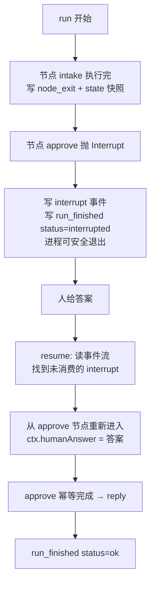

# agent-harness

> 生产级 Agent 运行时：**状态机 + 中断恢复 + 多 Agent 委派 + MCP 客户端/服务端 + Skill 加载 + 事件溯源 + 指标 + 评测**。

零运行时依赖，只用 Node 标准库。

---

## 一、这个项目解决什么问题

一个 Agent 在 demo 里能跑，和在生产里能跑，差的是这几件事：

| demo 能跑 | 生产要解决 |
|---|---|
| 一次请求内跑完 | 任务要跑十几分钟，中途要人等审批，进程重启要能续上 |
| 一个 Agent 干所有事 | 子任务上下文很长但结论很短，需要隔离出去 |
| 模型说调什么就调什么 | 权限白名单在代码层拦，不靠提示词自觉 |
| 把整段对话塞进 prompt | 技能按需加载，不相关的不占预算 |
| 出错就崩 | 错误分六类，各有各的处理方式 |
| 出问题看日志猜 | 每一步有结构化事件，能回放、能统计 |

这个项目把上面六件事都实现出来，并且**用测试和真实模型评测钉死**。

---

## 二、能重点学到什么

| 能力 | 具体落点 |
|---|---|
| **事件溯源** | 状态不存储、只存事件，`fold()` 重建；这才是「断点续跑」能成立的根 |
| **状态机 + 中断恢复** | `Interrupt` 用异常实现，恢复重入节点时必须幂等 |
| **MCP 双向** | 写客户端（能用别人的工具）+ 写服务端（能被别人当工具用） |
| **多 Agent 的正确形态** | 子 Agent 当工具，只回结论不回过程 |
| **Skill 按需加载** | 上下文预算有限，不能把所有指令都塞进 system prompt |
| **错误分类** | validation / business / network / timeout / permission / internal，六类处理不同 |
| **可观测** | trace（排障）与 metrics（告警）是两件事，不能混 |
| **判定式评测** | 用验收条件判定，不用 1–5 分打分 |

---

## 三、能应对什么样的提问

**「你的 Agent 跑到一半进程挂了怎么办？」**
> 状态不存内存，全部从事件流折叠。恢复时读 `events.jsonl`，找到最后一个未消费的 interrupt，从那个节点重新进入。节点重入必须幂等——用 `ctx.state` 判断这步是否已做过。测试里验证了：恢复后 `intake` 节点只进入过一次，`reply` 只执行一次。

**「多 Agent 怎么做的？」**
> 不是让几个 Agent 互相聊天，是父 Agent 把子 Agent 注册成一个工具。子 Agent 的完整过程写自己的事件流，只把结论和 runId 回给父。测试断言了：父 run 的 `llm_response` 里不会出现子 Agent 的工具调用，证明上下文确实隔离。

**「你懂 MCP 吗？」**
> 两种都写了。客户端走 stdio + JSON-RPC，实现 initialize 握手 → tools/list → tools/call；服务端严格实现「未初始化就调用要报错」。所以既能用别人的工具，也能被别人当工具用。

**「工具调用失败怎么办？」**
> 分六类。参数错回给模型让它改；业务错让它换策略；网络/超时有限重试；权限错明确告知不要重试；内部 bug 直接中断并上报，因为重试只会放大问题。测试里验证了内部错误只执行一次（不重试）。

**「怎么控制模型乱调工具？」**
> 权限在注册表层拦，不在提示词里。而且技能可以声明自己能用的工具集，没声明的调用直接返回 permission 错误。测试验证了「技能只声明 query_order 时，模型调 search_policy 会被拦」。

**「上下文怎么省？」**
> 技能按需加载（关键词匹配，不相关的不进 prompt）；思考块默认丢弃；子 Agent 隔离长上下文。省 token 的手段要能说清每个的代价——技能匹配是启发式，可能漏；丢思考块会损失一点推理连贯性。

**「你怎么证明它有效？」**
> 4 个真实模型 case，判定式：工具是否齐全、答复是否含关键依据、是否出现不该出现的否定表述、是否正常收尾。4/4 通过，附耗时和 token。

---

## 四、核心原理

### 4.1 事件是唯一事实源

```
不存状态 ──→ 恢复需要额外的快照机制，每次状态变化都要想「哪些字段要存」
存事件   ──→ 只追加；状态是 fold(events) 算出来的；回放、审计、评测归因免费得到
```

代价是查询慢，用 SQLite/Prometheus 补偿，但**事实源永远是 JSONL**。数据库删了能重建，事件流不能。

### 4.2 中断恢复的正确做法



**最容易写错的点**：恢复时如果从头重跑所有节点，副作用会重复执行（邮件发两次、退款扣两次）。所以节点必须自己判断「这一步做过没有」。

### 4.3 多 Agent：委派，不是对话

```mermaid
flowchart LR
    P[父 Agent 循环] -->|tool_use: delegate_logistics| T[子 Agent 作为工具]
    T --> S1[子 Agent 事件流<br/>自己的工具调用全部在这]
    S1 --> S2[只回 {childRunId, answer}]
    S2 --> P
    P --> R[父上下文只有结论<br/>不被子过程污染]
```

### 4.4 错误分类矩阵

| 类别 | 回给模型 | 重试 | 中段处理 |
|---|---|---|---|
| validation | ✅ | ❌ | 让它改参数 |
| business | ✅ | ❌ | 让它换策略 |
| network | ✅ | ✅ 2 次 | 有限重试后告知 |
| timeout | ✅ | ✅ 1 次 | 同上 |
| permission | ✅ | ❌ | 明确说不要重试 |
| internal | ❌ | ❌ | **立即中断并抛出** |

---

## 五、技术栈

| 项 | 选择 | 理由 |
|---|---|---|
| 运行时 | Node.js ≥ 20 | 原生 fetch、内置测试运行器 |
| 语言 | ESM JavaScript + JSDoc | 零构建，Docker 里直接跑 |
| 依赖 | **0 个运行时依赖** | harness 是纯编排逻辑，引框架会增加不可控因素 |
| 协议 | JSON-RPC 2.0 over stdio（MCP） | 自己的实现，能看清握手细节 |
| 服务 | `node:http` | 路由少，不值得引框架 |
| 指标 | Prometheus 文本格式 | 拉模型，无需 SDK |
| 测试 | `node --test` | 42 个测试，含真起 MCP 子进程的端到端 |

---

## 六、快速开始

```bash
git clone https://github.com/rnnhean/agent-harness.git
cd agent-harness

npm test          # 42 个测试
npm run demo      # 离线演示：技能加载 / 错误分类 / 中断恢复
npm run eval      # 真实模型评测（需要环境变量）
npm run serve     # 服务模式，默认 8790

# MCP server（可被 Claude Code 等直接接）
npm run mcp
```

### 接入真实模型

```js
import { createAgent, anthropicClient, buildExampleTools } from 'agent-harness';

const agent = createAgent({
    llm: anthropicClient({ model: process.env.LLM_MODEL, baseUrl: process.env.LLM_BASE_URL }),
    tools: buildExampleTools(),
    eventDir: './runs',
    system: '你是客服助手',
    skillsDir: './examples/skills',
});
const r = await agent.run('我的订单 A1001 到哪了');
```

凭据只从环境变量读，不打印、不落盘、不进事件。

### 接成 MCP 服务

```json
{
  "mcpServers": {
    "agent-harness": { "command": "node", "args": ["/path/to/agent-harness/src/mcp/server.mjs"] }
  }
}
```

---

## 七、部署

```bash
docker build -t agent-harness .
docker run -p 8790:8790 --env-file env.example agent-harness
```

| 路由 | 说明 |
|---|---|
| `GET /health` | 健康检查 |
| `GET /metrics` | Prometheus 指标 |
| `GET /api/runs` | 运行列表 |
| `GET /api/runs/:id` | 轨迹（`?raw=1` 拿原始事件） |
| `POST /api/run` | 立刻返回 runId，后台执行 |

**边界**：无鉴权（内网 sidecar）；事件存文件（多实例需共享存储）；请求体 2MB 上限。

---

## 八、监控

| 指标 | 用来回答 |
|---|---|
| `harness_runs_total` / `_ok` / `_failed` / `_interrupted` | 成功率与中断率 |
| `harness_tool_errors_total{kind}` | 哪类错误最多（business 多 = 数据/话术问题；internal 多 = 有 bug） |
| `harness_turns_total` | 平均轮次是否膨胀（膨胀 = 模型在打转） |
| `harness_input_tokens_total` / `_output_tokens_total` | 成本 |
| `harness_run_duration_seconds_sum` / `_count` | 耗时 |
| `harness_success_ratio` | 直接告警用 |

---

## 九、评测（真实模型）

| case | 验收条件 |
|---|---|
| query_shipped | 必须调 query_order + query_logistics；答复含物流状态；不出现「不存在」 |
| order_missing | 必须调 query_order；答复说明订单不存在；不编造物流 |
| bad_format | 必须调 query_order；答复指出格式问题 |
| policy_compensation | 必须调 query_order + search_policy；答复引用补偿规则（10%/200/审批） |

实测 4/4 通过，耗时 1.9–5.9s，token 892–1142 输入。

---

## 十、局限（说实话）

1. **技能匹配是关键词启发式**，任务描述和技能描述用词差异大时会漏。真实项目应换语义检索。
2. **归档/状态都在本地文件**，多实例部署需要换成共享存储。
3. **没有实现 MCP 的 resources / prompts 能力**，只做了 tools。
4. **摘要与压缩没有内置**（那是 agent-compaction 的职责，两者可组合）。
5. **没有做鉴权与多租户**，定位是内网 sidecar。

---

## 十一、许可

MIT
